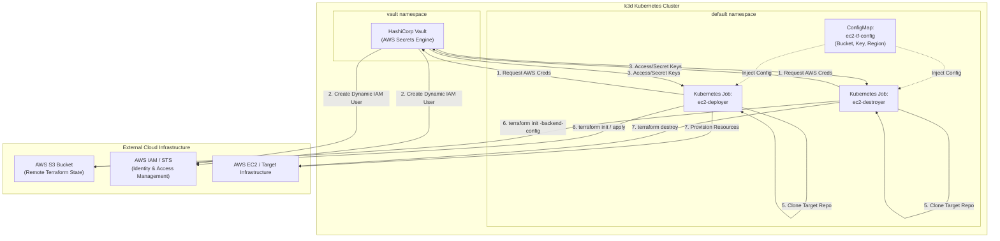

Automated Ephemeral Terraform Runner on Kubernetes (k3d + Vault + S3)
An end-to-end GitOps/Kubernetes pattern for executing non-interactive, stateless Terraform deployments and teardowns using dynamic AWS credentials provided by HashiCorp Vault and remote state stored in S3.
By changing the `GIT_REPO_URL` and target state details in the Kubernetes manifests, you can re-use this pattern for any infrastructure repository.
---
Architecture Overview

---
Key Lessons Learned
> **CRITICAL: IAM Credentials Propagation Delay**  
> When Vault generates dynamic IAM credentials (`credential_type = iam-user`), AWS requires a **10–15 second global propagation window** before those temporary access keys are recognized by S3, STS, or EC2 endpoints. Running `terraform init` immediately upon receiving keys from Vault will result in sporadic `403 InvalidClientTokenId` or `AccessDenied` errors. An explicit delay (`sleep 15`) is mandatory prior to execution.
---
Step 1: Local Environment Setup
1. Create k3d Cluster
```bash
k3d cluster create tf-runner-cluster --agents 1
```
2. Install HashiCorp Vault via Helm
```bash
helm repo add hashicorp https://helm.releases.hashicorp.com
helm repo update

kubectl create namespace vault

helm install vault hashicorp/vault \
  --namespace vault \
  --set "server.dev.enabled=true" \
  --set "server.dev.devRootToken=root"
```
3. Configure Vault AWS Secrets Engine
Exec into the Vault pod to enable and configure the AWS secrets engine with your master administrative AWS keys:
```bash
kubectl exec -it vault-0 -n vault -- sh
```
Inside `vault-0`:
```sh
# Enable AWS Secrets Engine
vault secrets enable aws

# Configure AWS Root credentials in Vault
vault write aws/config/root \
    access_key="YOUR_AWS_ROOT_ACCESS_KEY" \
    secret_key="YOUR_AWS_ROOT_SECRET_KEY" \
    region="us-east-1"

# Create a role for Terraform with IAM user dynamic credentials
vault write aws/roles/terraform-role \
    credential_type=iam-user \
    policy_arns="arn:aws:iam::aws:policy/AdministratorAccess"

exit
```
---
Step 2: Shared ConfigMap
Create the ConfigMap containing the S3 state configuration used by both deployer and destroyer jobs:
```yaml
cat <<EOF | kubectl apply -f -
apiVersion: v1
kind: ConfigMap
metadata:
  name: ec2-tf-config
data:
  TF_STATE_BUCKET: "your-terraform-state-bucket-name"
  TF_STATE_KEY: "ec2-vault/terraform.tfstate"
  AWS_REGION: "us-east-1"
  GIT_REPO_URL: "https://github.com/your-org/your-tf-repo.git"
EOF
```
---
Step 3: Deployment Job (`ec2-deployer.yaml`)
This job clones the specified Git repository, injects the backend configuration, waits for IAM credentials to propagate, and runs `terraform apply`.
```yaml
apiVersion: batch/v1
kind: Job
metadata:
  name: ec2-deployer
spec:
  ttlSecondsAfterFinished: 300
  template:
    spec:
      restartPolicy: Never
      containers:
      - name: terraform-runner
        image: hashicorp/terraform:latest
        workingDir: /src
        command: ["/bin/sh", "-c"]
        args:
          - |
            set -e

            echo "==> Installing utilities (curl, git, jq)..."
            apk add --no-cache curl git jq

            echo "==> Fetching dynamic AWS credentials from Vault..."
            VAULT_RESPONSE=$(curl -s --fail \
              --header "X-Vault-Token: root" \
              http://vault.vault.svc.cluster.local:8200/v1/aws/creds/terraform-role)

            export AWS_ACCESS_KEY_ID=$(echo "$VAULT_RESPONSE" | jq -r '.data.access_key')
            export AWS_SECRET_ACCESS_KEY=$(echo "$VAULT_RESPONSE" | jq -r '.data.secret_key')

            echo "==> WAITING 15 Seconds for AWS IAM Global Credential Propagation..."
            sleep 15

            echo "==> Cloning infrastructure repository..."
            git clone "${GIT_REPO_URL}" .

            echo "==> Generating backend configuration..."
            cat <<EOF > backend.hcl
            bucket = "${TF_STATE_BUCKET}"
            key    = "${TF_STATE_KEY}"
            region = "${AWS_REGION}"
            EOF

            echo "==> Initializing Terraform..."
            terraform init -backend-config=backend.hcl

            echo "==> Executing Terraform Apply..."
            terraform apply -auto-approve

        envFrom:
        - configMapRef:
            name: ec2-tf-config
```
Run deployment:
```bash
kubectl apply -f ec2-deployer.yaml
kubectl logs -f job/ec2-deployer
```
---
Step 4: Destruction Job (`ec2-destroyer.yaml`)
This job connects to the exact same remote S3 state file using dynamic credentials and completely tears down all managed infrastructure.
```yaml
apiVersion: batch/v1
kind: Job
metadata:
  name: ec2-destroyer
spec:
  ttlSecondsAfterFinished: 300
  template:
    spec:
      restartPolicy: Never
      containers:
      - name: terraform-runner
        image: hashicorp/terraform:latest
        workingDir: /src
        command: ["/bin/sh", "-c"]
        args:
          - |
            set -e

            echo "==> Installing utilities (curl, git, jq)..."
            apk add --no-cache curl git jq

            echo "==> Fetching dynamic AWS credentials from Vault..."
            VAULT_RESPONSE=$(curl -s --fail \
              --header "X-Vault-Token: root" \
              http://vault.vault.svc.cluster.local:8200/v1/aws/creds/terraform-role)

            export AWS_ACCESS_KEY_ID=$(echo "$VAULT_RESPONSE" | jq -r '.data.access_key')
            export AWS_SECRET_ACCESS_KEY=$(echo "$VAULT_RESPONSE" | jq -r '.data.secret_key')

            echo "==> WAITING 15 Seconds for AWS IAM Global Credential Propagation..."
            sleep 15

            echo "==> Cloning infrastructure repository..."
            git clone "${GIT_REPO_URL}" .

            echo "==> Generating backend configuration..."
            cat <<EOF > backend.hcl
            bucket = "${TF_STATE_BUCKET}"
            key    = "${TF_STATE_KEY}"
            region = "${AWS_REGION}"
            EOF

            echo "==> Initializing Terraform..."
            terraform init -backend-config=backend.hcl

            echo "==> Executing Terraform Destroy..."
            terraform destroy -auto-approve

        envFrom:
        - configMapRef:
            name: ec2-tf-config
```
Run teardown:
```bash
kubectl apply -f ec2-destroyer.yaml
kubectl logs -f job/ec2-destroyer
```